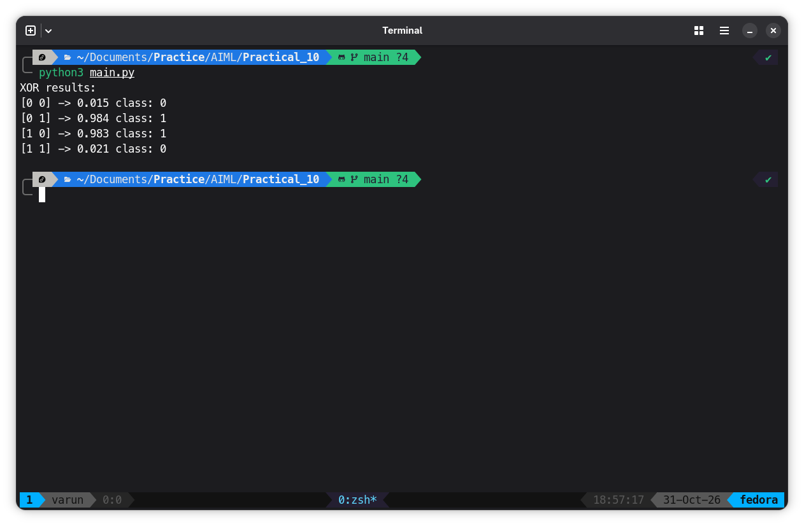

# Program
```python
import numpy as np
 
# XOR examples: inputs and the correct answers
X = np.array([
    [0, 0],
    [0, 1],
    [1, 0],
    [1, 1]
], dtype=float)
 
y = np.array([
    [0],
    [1],
    [1],
    [0]
], dtype=float)
 
# Fix random numbers so results are repeatable
np.random.seed(1)
 
# Two input values, two hidden neurons, and one output neuron
input_size = 2
hidden_size = 2
output_size = 1
 
# Start with small random weights and zero biases
W1 = np.random.randn(input_size, hidden_size)
b1 = np.zeros((1, hidden_size))
W2 = np.random.randn(hidden_size, output_size)
b2 = np.zeros((1, output_size))
 
# Sigmoid turns a number into a value between 0 and 1
def sigmoid(z):
    return 1 / (1 + np.exp(-z))
 
# Derivative used to update weights during learning
def sigmoid_derivative(a):
    return a * (1 - a)
 
learning_rate = 0.5
 
# Repeat training many times
for epoch in range(10000):
    # Forward pass: calculate the network's output
    hidden_input = np.dot(X, W1) + b1
    hidden_output = sigmoid(hidden_input)
    final_input = np.dot(hidden_output, W2) + b2
    prediction = sigmoid(final_input)
 
    # Backpropagation: calculate how much each layer contributed to error
    output_error = y - prediction
    output_delta = output_error * sigmoid_derivative(prediction)
    hidden_error = np.dot(output_delta, W2.T)
    hidden_delta = hidden_error * sigmoid_derivative(hidden_output)
 
    # Update weights and biases to reduce the error
    W2 += learning_rate * np.dot(hidden_output.T, output_delta)
    b2 += learning_rate * np.sum(output_delta, axis=0, keepdims=True)
    W1 += learning_rate * np.dot(X.T, hidden_delta)
    b1 += learning_rate * np.sum(hidden_delta, axis=0, keepdims=True)
 
# Show the final predictions
print("XOR results:")
for i in range(len(X)):
    result = sigmoid(sigmoid(np.dot(X[i:i+1], W1) + b1) @ W2 + b2)[0, 0]
    answer = 1 if result >= 0.5 else 0
    print(X[i].astype(int), "->", round(float(result), 3), "class:", answer)
```

## Output

