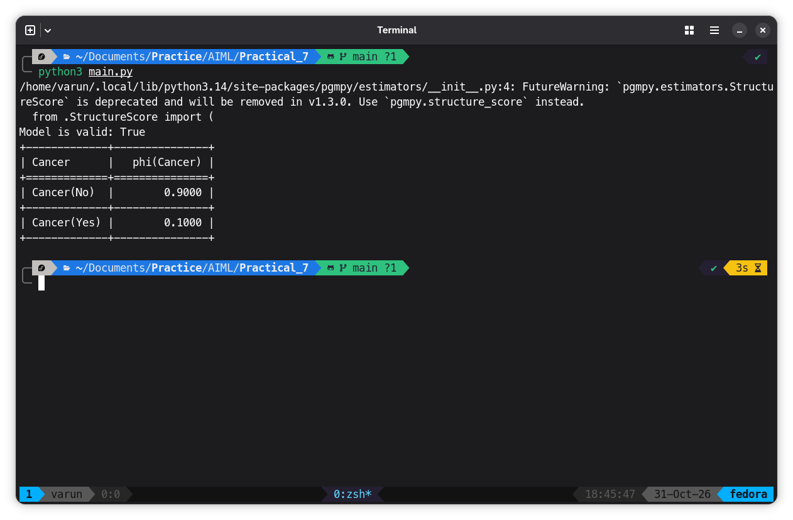

# Program
```python
from pgmpy.models import DiscreteBayesianNetwork
from pgmpy.factors.discrete import TabularCPD
from pgmpy.inference import VariableElimination

# Create the network
model = DiscreteBayesianNetwork([
    ("Smoking", "Cancer")
])

# Probability of Smoking
smoking = TabularCPD(
    "Smoking",
    2,
    [[0.7], [0.3]],
    state_names={"Smoking": ["No", "Yes"]}
)

# Probability of Cancer depending on Smoking
cancer = TabularCPD(
    "Cancer",
    2,
    [[0.99, 0.90],
     [0.01, 0.10]],
    evidence=["Smoking"],
    evidence_card=[2],
    state_names={
        "Cancer": ["No", "Yes"],
        "Smoking": ["No", "Yes"]
    }
)

# Add probabilities to the network
model.add_cpds(smoking, cancer)

# Check the network
print("Model is valid:", model.check_model())

# Create inference
inference = VariableElimination(model)

# Person is a smoker
result = inference.query(
    ["Cancer"],
    evidence={"Smoking": "Yes"}
)

# Display result
print(result)
```

## Output

