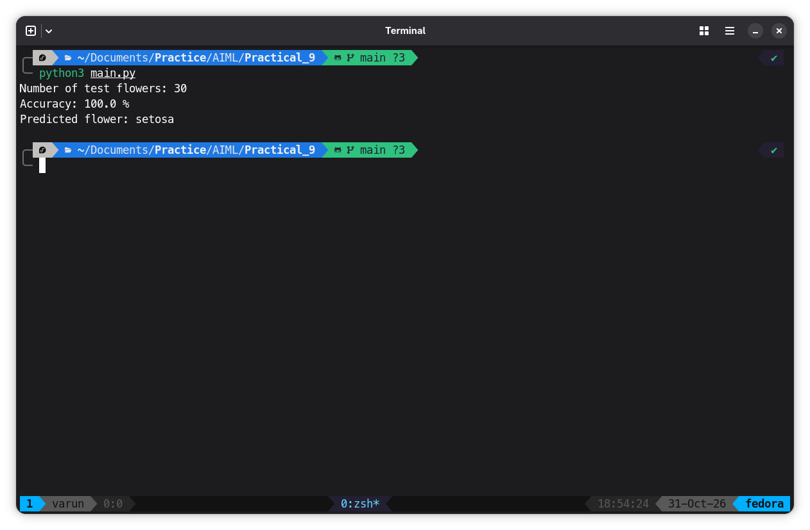

# Program
```python
# Load tools for the K-Nearest Neighbors model
from sklearn.datasets import load_iris
from sklearn.model_selection import train_test_split
from sklearn.neighbors import KNeighborsClassifier
from sklearn.metrics import accuracy_score
 
# Load the built-in Iris flower dataset
iris = load_iris()
X = iris.data       # Four measurements for each flower
y = iris.target     # Flower class: 0, 1, or 2
 
# Keep some data for testing and use the rest for training
X_train, X_test, y_train, y_test = train_test_split(
    X, y, test_size=0.2, random_state=42
)
 
# Create a KNN model using the 3 nearest neighbours
model = KNeighborsClassifier(n_neighbors=3)
 
# Learn from the training examples
model.fit(X_train, y_train)
 
# Predict classes for the test examples
predictions = model.predict(X_test)
 
# Compare predictions with the correct answers
accuracy = accuracy_score(y_test, predictions)
print("Number of test flowers:", len(y_test))
print("Accuracy:", round(accuracy * 100, 2), "%")
 
# Predict the class of one new flower
new_flower = [[5.1, 3.5, 1.4, 0.2]]
predicted_class = model.predict(new_flower)[0]
print("Predicted flower:", iris.target_names[predicted_class])
```

## Output

