# MMC Practicals
## 3. LED blinking using Arduino UNO (Digital Write).
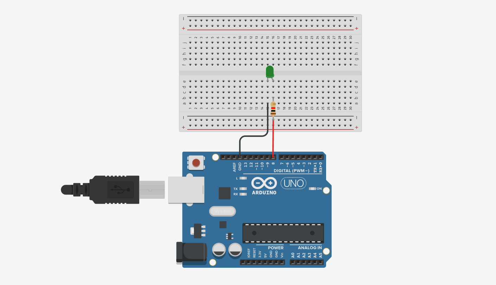
```C
int LED = 8;

void setup()
{
  pinMode(LED, OUTPUT);
}

void loop()
{
  digitalWrite(LED, HIGH);
  delay(1000);
  digitalWrite(LED, LOW);
  delay(1000);
}
```
```bookmark
https://www.tinkercad.com/things/d8fwMRVq4uE-practical-3?sharecode=Uz5cmnvoCbTMoQuvyPw4g0kxl29TgFk8ETvPQp-xkdE
```
## 4. Controlling LED using push button with Arduino UNO (Digital Read).
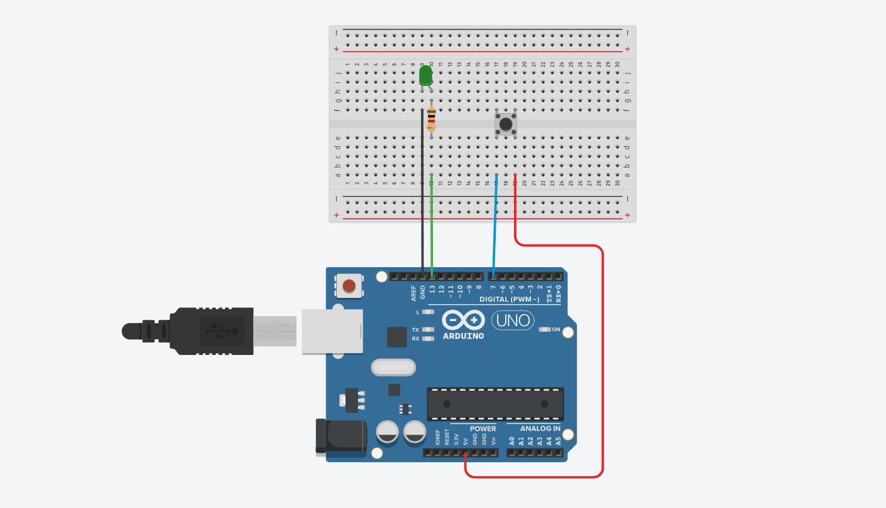
```C
void setup()
{
  pinMode(13, OUTPUT);
  pinMode(7, INPUT);
}

void loop()
{
  int button = 0;
  button = digitalRead(7);
  
  if(button == HIGH)
  {
    digitalWrite(13, HIGH);
  }
  else
  {
    digitalWrite(13, LOW);
  }
}
```
```bookmark
https://www.tinkercad.com/things/l0dW1BR9xxa-practical-4?sharecode=kQw64QrzhF7qIU5w8--nDnL7KOjoT7UqY53fL_aoO3o
```
## 5. Interfacing potentiometer with Arduino UNO (Analog Read).
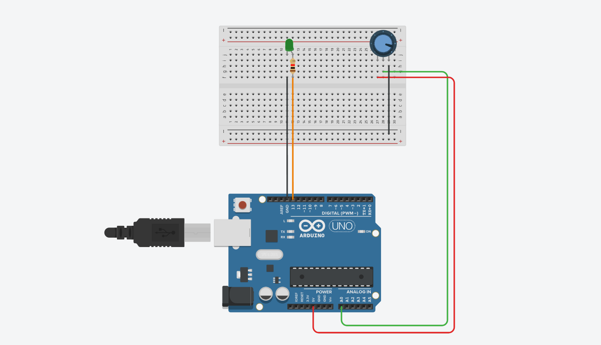
```C
// C code

int potValue;
int outputvalue;

void setup()
{
  Serial.begin(9600);
  pinMode(A0, INPUT);
  pinMode(13, OUTPUT);
}

void loop()
{
  potValue = analogRead(A0);
  outputvalue = map(potValue, 0, 1023, 0, 255);
  analogWrite(13,outputvalue);
  Serial.println(outputvalue);
}
```
```bookmark
https://www.tinkercad.com/things/ip51TVTtOTu-practical-5?sharecode=O38o_JWnyAOAMPWsTtStlBwhilJmbhhUIxHsNoCF1sQ
```
## 6. Smart lighting system using LDR and Arduino UNO.
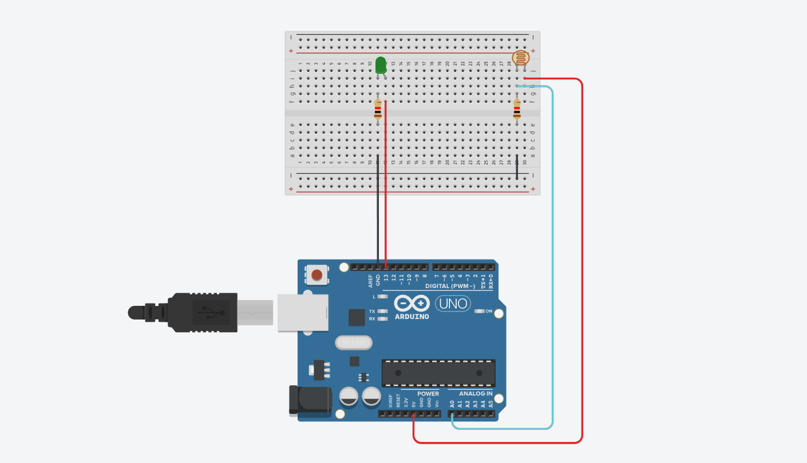
```C
// C code

void setup()
{
  Serial.begin(9600);
  pinMode(13, OUTPUT);
  pinMode(A0, INPUT);
}

void loop()
{
  int LDRStatus = analogRead(A0);
  if(LDRStatus >= 512)
  {
    digitalWrite(13, HIGH);
    Serial.print("Value - ");
    Serial.println(LDRStatus);
  }
  else
  {
    digitalWrite(13, LOW);
    Serial.print("Value - ");
    Serial.println(LDRStatus);
  }
}
```
```bookmark
https://www.tinkercad.com/things/99FkPgxbzDI-practical-6?sharecode=pn_Wdljw19_08MxfZpbQ3K_B2DCx3_LXmOmQFloZoC0
```
## 7. Motion Detection using PIR Sensor and Arduino UNO.
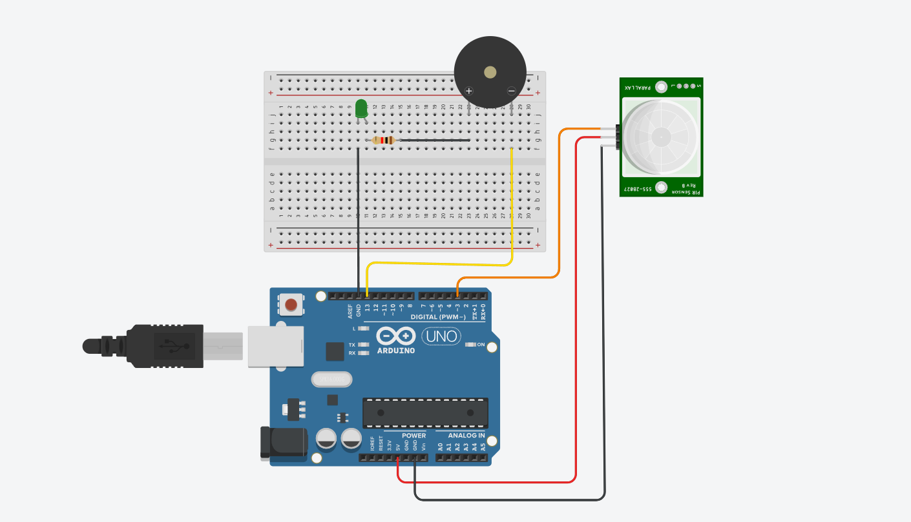
```C
void setup()
{
  pinMode(3, INPUT);
  pinMode(13, OUTPUT);
  Serial.begin(9600);
}

void loop()
{
  int motion = 0;
  motion = digitalRead(3);
  if(motion == HIGH)
  {
    digitalWrite(13, HIGH);
    Serial.println(motion);
    Serial.println("motion detected");
  }
  else
  {
    digitalWrite(13, LOW);
    Serial.println(motion);
    Serial.println("motion not detected"); 
  }
}
```
```bookmark
https://www.tinkercad.com/things/jfGZ9fFH4tr-practical-7?sharecode=pRMJnve4p7bbype4vElVb0xa0jx701Qt1PT2v_p605M
```
## 8. Temperature measurement using thermistor LM35/DHT11 and Arduino UNO.
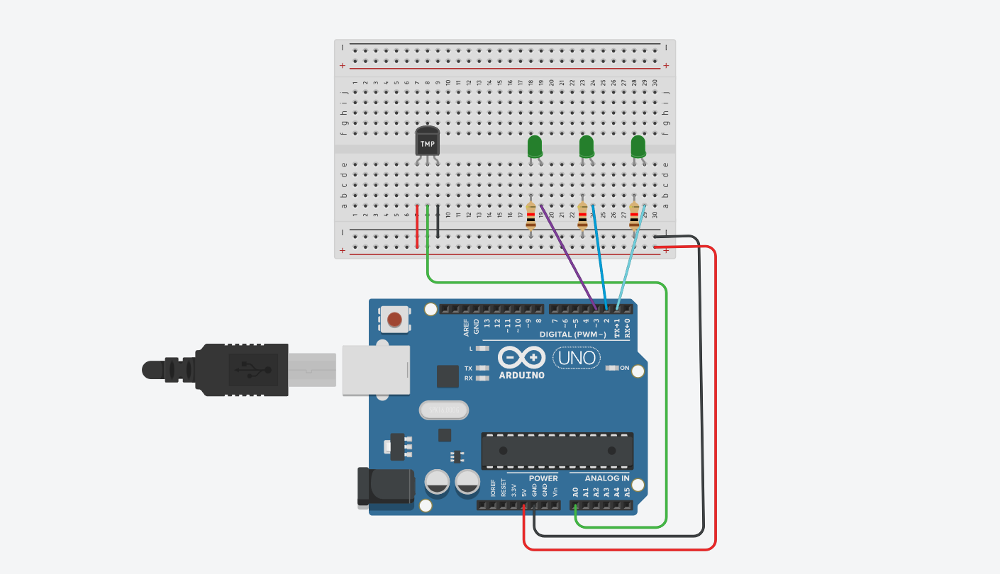
```C
int sensorValue = 0;

void setup(){
  Serial.begin(9600);
  pinMode(A1,INPUT);
  pinMode(1,OUTPUT);
  pinMode(2,OUTPUT);
}

void loop(){
  sensorValue = analogRead(A1);
  int temp = (sensorValue * 5.0 * 100)/1024;
              
  Serial.print("Temprature: ");
  Serial.print(temp);
  Serial.println(" C");
  delay(100);
  
  if(sensorValue <= 60){
    digitalWrite(1,HIGH);
    digitalWrite(2,LOW);
    Serial.print("Temprature is very low");
  }
  else{
    digitalWrite(1,LOW);
    digitalWrite(2,HIGH);
    Serial.println("Temprature is very high");
  }
  
  Serial.print("Raw ADC value: ");
  Serial.println(sensorValue);
}
```
```bookmark
https://www.tinkercad.com/things/dwuGZ2WsN3T-practical-8?sharecode=Zzx8dDeoGkFZGNiw2uPx067k-W3btUYOFwxjJxmA8-o
```
## 9. Distance measurement using SR-04 and Arduino UNO.
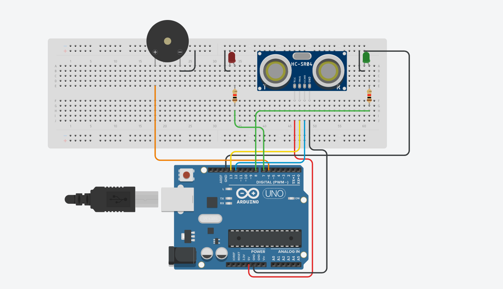
```C
int trigger = 13;
int echo = 12;
int buzzer = 6;
int greenLed = 8;
int redLed = 7;

long duration = 0;
int distance = 0;
int inch = 0;

void setup() {
  Serial.begin(9600);
  pinMode(trigger, OUTPUT);
  pinMode(echo, INPUT);
  pinMode(buzzer, OUTPUT);
  pinMode(greenLed, OUTPUT);
  pinMode(redLed, OUTPUT);
}

void loop() {
  digitalWrite(trigger, LOW);
  delayMicroseconds(2);
  digitalWrite(trigger, HIGH);
  delayMicroseconds(10);
  digitalWrite(trigger, LOW);

  duration = pulseIn(echo, HIGH);
  distance = duration * 0.034 / 2;

  inch = distance * 0.393701;
  if (inch < 35) {
    digitalWrite(buzzer, HIGH);
    digitalWrite(redLed, HIGH);
    digitalWrite(greenLed, LOW);
  }
  else {
    digitalWrite(buzzer, LOW);
    digitalWrite(redLed, LOW);
    digitalWrite(greenLed, HIGH);
  }

  Serial.print("duration is: ");
  Serial.print(duration);
  Serial.print("Distance is: ");
  Serial.print(inch);
  Serial.println(" inches");
  delay(100);
}
```
```bookmark
https://www.tinkercad.com/things/aA0JSdxfBRV-practical-9?sharecode=iSE_3ABdl8JkxY0xFQLbMnD4J2YCNG5B5JYE1BOxaC8
```
## 10. Gas detection using MQ135/MQ2 and Arduino UNO.
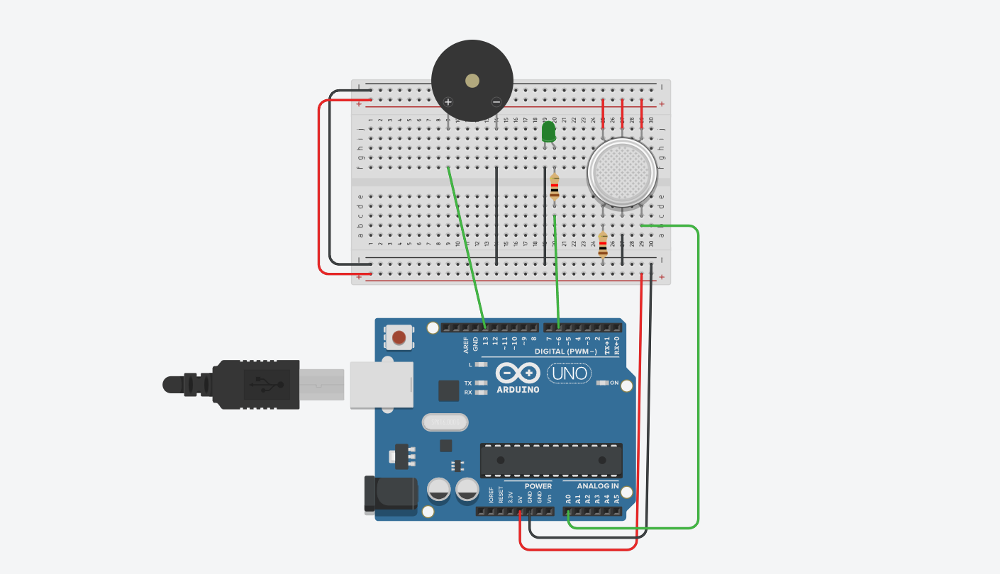
```C
int gasValue = 0;     
int threshold = 150; 

void setup() {
  Serial.begin(9600);   
  pinMode(13, OUTPUT); 
  pinMode(6, OUTPUT);  
  pinMode(A0, INPUT);   
  Serial.println("Gas Detection System Started...");
}

void loop() {
  gasValue = analogRead(A0);  
  Serial.print("Gas Value: ");
  Serial.println(gasValue);

  if (gasValue > threshold) {
    digitalWrite(13, HIGH);
    digitalWrite(6, HIGH);
    Serial.println("Gas Detected! Take Action!");
    delay(1000);  
  }
  else {
    digitalWrite(13, LOW);
    digitalWrite(6, LOW);
  }

  delay(500);
}
```
```bookmark
https://www.tinkercad.com/things/cCZRkhOGxv0-practical-10?sharecode=wfOldfAiFPp3KaqS1KkDJN4QTdf661q52qahyKjbvts
```
## 11. Servo motor (SG-90) control using Arduino UNO.
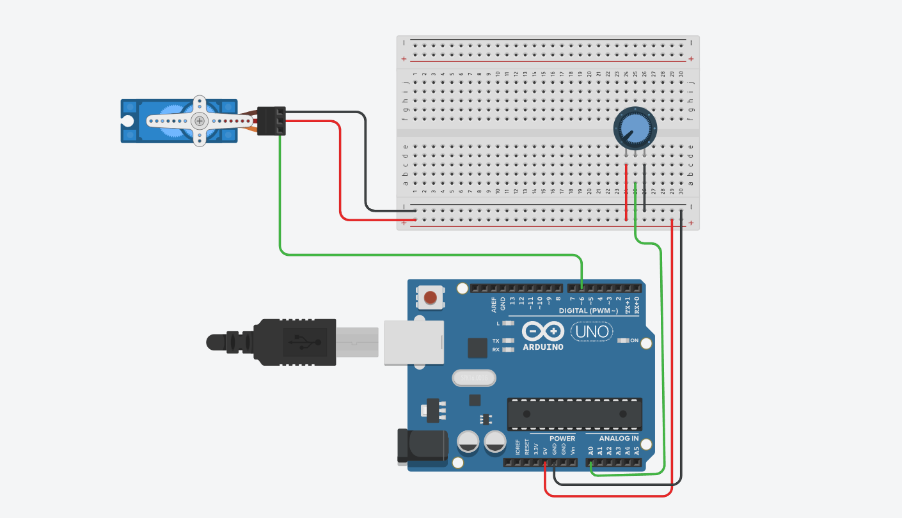
```C
#include <Servo.h>

Servo myServo; 

void setup() {
  Serial.begin(9600);
  myServo.attach(6); 
}

void loop() {
  myServo.write(0); 
  Serial.println("Position: 0");
  delay(2000);

  myServo.write(90);
  Serial.println("Position: 90");
  delay(2000);

  myServo.write(180); 
  Serial.println("Position: 180");
  delay(2000);
}
```
```bookmark
https://www.tinkercad.com/things/ie8WbfLxvLZ-practical-11?sharecode=H1WYYTxrc33Hn4CxsDysoCmws-dRcvItQTB03IHknaE
```
## 12. Home Appliances control using Relay and Arduino UNO (Interfacing Relay to Arduino).
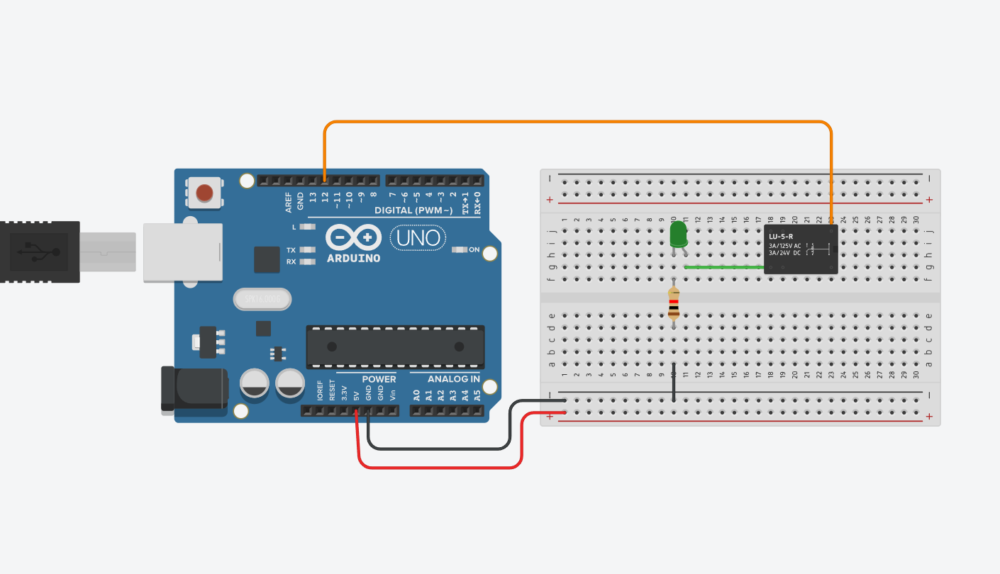
```C
const int relayPin = 12;

void setup() {
  pinMode(relayPin, OUTPUT);
}

void loop() {
  digitalWrite(relayPin, HIGH);
  delay(1000);
  digitalWrite(relayPin, LOW);
  delay(1000);
}
```
```bookmark
https://www.tinkercad.com/things/lWQgrOO1Rqp-practical-12?sharecode=aBwhpJohuvH8LB4W3jmMRYC-vuHsSzJfsQnVXh44NX0
```
## 13. DC motor control using Arduino UNO.
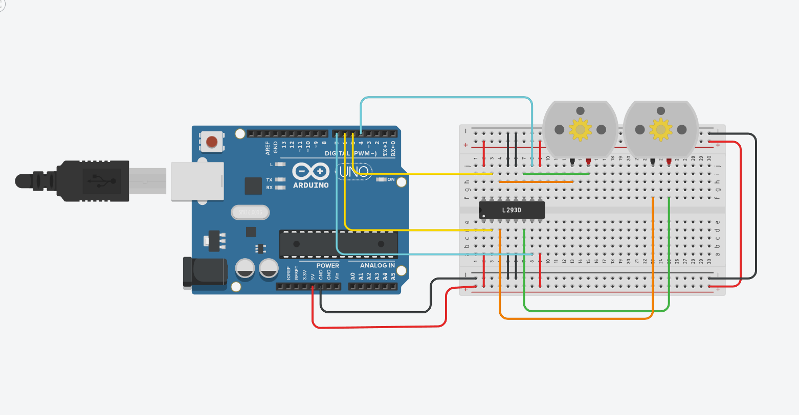
```C
int in1 = 6;
int in2 = 7;
int in3 = 4;
int in4 = 5;

void setup() {
  pinMode(in1, OUTPUT);
  pinMode(in2, OUTPUT);
  pinMode(in3, OUTPUT);
  pinMode(in4, OUTPUT);
}

void loop() {
  digitalWrite(in1, HIGH);
  digitalWrite(in2, LOW);
  digitalWrite(in3, HIGH);
  digitalWrite(in4, LOW);
  delay(2000);

  digitalWrite(in1, LOW);
  digitalWrite(in2, LOW);
  digitalWrite(in3, LOW);
  digitalWrite(in4, LOW);
  delay(1000);

  digitalWrite(in1, LOW);
  digitalWrite(in2, HIGH);
  digitalWrite(in3, LOW);
  digitalWrite(in4, HIGH);
  delay(2000);

  digitalWrite(in1, LOW);
  digitalWrite(in2, LOW);
  digitalWrite(in3, LOW);
  digitalWrite(in4, LOW);
  delay(1000);
}
```
```bookmark
https://www.tinkercad.com/things/jlRNs3girFS-practical-13?sharecode=htNOL0HeXjzTStWSs8hrGV4Yl78vCsnZGF8dTbNLL60
```