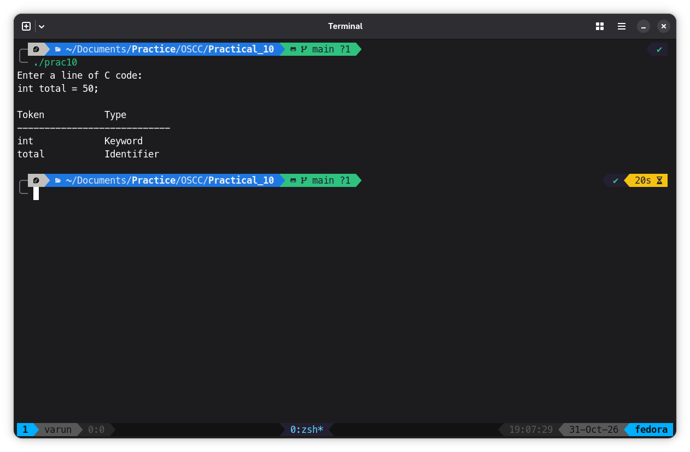

# Program

```C
#include <stdio.h>
#include <string.h>
#include <ctype.h>

#define MAX 1000
#define TOKEN_SIZE 100

// List of 32 traditional C keywords
char keywords[32][20] = {
    "auto", "break", "case", "char",
    "const", "continue", "default", "do",
    "double", "else", "enum", "extern",
    "float", "for", "goto", "if",
    "int", "long", "register", "return",
    "short", "signed", "sizeof", "static",
    "struct", "switch", "typedef", "union",
    "unsigned", "void", "volatile", "while"
};

// Function to check keyword
int isKeyword(char word[]) {
    int i;

    for (i = 0; i < 32; i++) {
        if (strcmp(word, keywords[i]) == 0) {
            return 1;
        }
    }

    return 0;
}

int main() {
    char input[MAX];
    char token[TOKEN_SIZE];
    int i = 0, j;

    printf("Enter a line of C code:\n");
    fgets(input, sizeof(input), stdin);

    printf("\nToken\t\tType\n");
    printf("----------------------------\n");

    while (input[i] != '\0') {

        // Check for alphabet or underscore
        if (isalpha((unsigned char)input[i])
            || input[i] == '_') {

            j = 0;

            // Collect identifier or keyword
            while (isalnum((unsigned char)input[i])
                   || input[i] == '_') {

                if (j < TOKEN_SIZE - 1) {
                    token[j++] = input[i];
                }

                i++;
            }

            token[j] = '\0';

            if (isKeyword(token)) {
                printf("%-15s Keyword\n", token);
            } else {
                printf("%-15s Identifier\n", token);
            }

        } else {
            i++;
        }
    }

    return 0;
}
```

## Output

