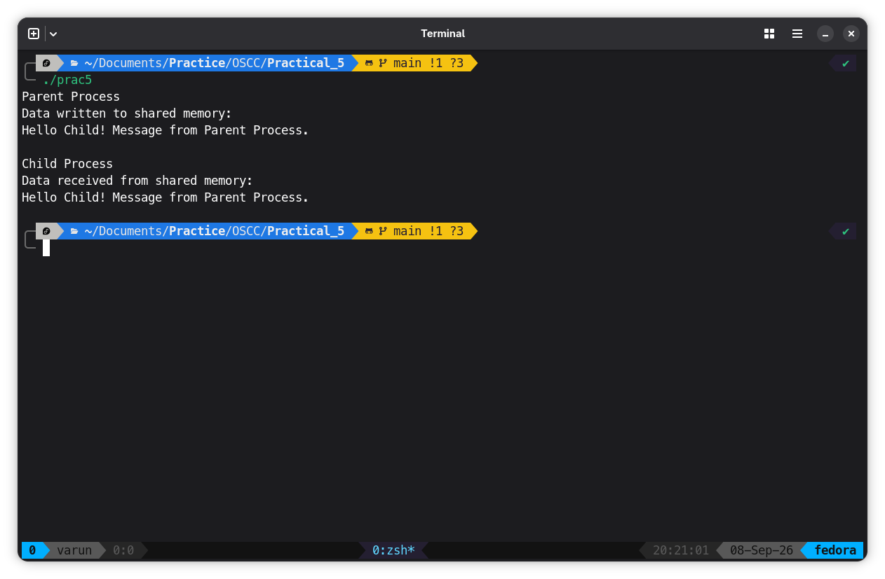

# Program
```C
#include <stdio.h>
#include <stdlib.h>
#include <string.h>
#include <unistd.h>
#include <sys/ipc.h>
#include <sys/shm.h>
#include <sys/wait.h>

int main()
{
    int shmid;
    char *shared_memory;
    pid_t pid;

    // Create shared memory
    shmid = shmget(IPC_PRIVATE, 1024, 0666 | IPC_CREAT);

    if (shmid < 0)
    {
        printf("Shared memory creation failed.\n");
        exit(1);
    }

    // Attach shared memory
    shared_memory = (char *)shmat(shmid, NULL, 0);

    if (shared_memory == (char *)-1)
    {
        printf("Shared memory attachment failed.\n");
        exit(1);
    }

    // Create child process
    pid = fork();

    if (pid < 0)
    {
        printf("Process creation failed.\n");
        exit(1);
    }

    if (pid > 0)
    {
        // Parent Process
        strcpy(shared_memory, "Hello Child! Message from Parent Process.");

        printf("Parent Process\n");
        printf("Data written to shared memory:\n");
        printf("%s\n", shared_memory);

        wait(NULL);

        // Detach shared memory
        shmdt(shared_memory);

        // Remove shared memory
        shmctl(shmid, IPC_RMID, NULL);
    }
    else
    {
        // Child Process
        sleep(1);

        printf("\nChild Process\n");
        printf("Data received from shared memory:\n");
        printf("%s\n", shared_memory);

        // Detach shared memory
        shmdt(shared_memory);
    }

    return 0;
}
```

## Output

