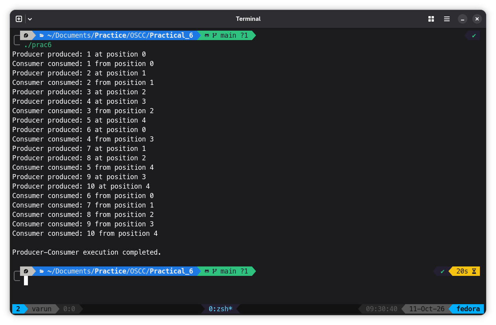

# Program
```C
#include <stdio.h>
#include <stdlib.h>
#include <pthread.h>
#include <semaphore.h>
#include <unistd.h>

#define BUFFER_SIZE 5
#define TOTAL_ITEMS 10

int buffer[BUFFER_SIZE];

int in = 0;
int out = 0;

sem_t empty;
sem_t full;

pthread_mutex_t mutex;

/* Producer Thread */
void *producer(void *arg)
{
    int item;

    for (int i = 1; i <= TOTAL_ITEMS; i++)
    {
        item = i;

        /* Wait for an empty position */
        sem_wait(&empty);

        /* Enter critical section */
        pthread_mutex_lock(&mutex);

        buffer[in] = item;

        printf("Producer produced: %d at position %d\n",
               item, in);

        in = (in + 1) % BUFFER_SIZE;

        /* Leave critical section */
        pthread_mutex_unlock(&mutex);

        /* Inform consumer that an item is available */
        sem_post(&full);

        sleep(1);
    }

    return NULL;
}

/* Consumer Thread */
void *consumer(void *arg)
{
    int item;

    for (int i = 1; i <= TOTAL_ITEMS; i++)
    {
        /* Wait until an item is available */
        sem_wait(&full);

        /* Enter critical section */
        pthread_mutex_lock(&mutex);

        item = buffer[out];

        printf("Consumer consumed: %d from position %d\n",
               item, out);

        out = (out + 1) % BUFFER_SIZE;

        /* Leave critical section */
        pthread_mutex_unlock(&mutex);

        /* Inform producer that a position is empty */
        sem_post(&empty);

        sleep(2);
    }

    return NULL;
}

int main()
{
    pthread_t producerThread, consumerThread;

    /* Initialize semaphores */
    sem_init(&empty, 0, BUFFER_SIZE);
    sem_init(&full, 0, 0);

    /* Initialize mutex */
    pthread_mutex_init(&mutex, NULL);

    /* Create threads */
    pthread_create(&producerThread, NULL,
                   producer, NULL);

    pthread_create(&consumerThread, NULL,
                   consumer, NULL);

    /* Wait for threads to finish */
    pthread_join(producerThread, NULL);
    pthread_join(consumerThread, NULL);

    /* Destroy synchronization objects */
    sem_destroy(&empty);
    sem_destroy(&full);
    pthread_mutex_destroy(&mutex);

    printf("\nProducer-Consumer execution completed.\n");

    return 0;
}
```

## Output

