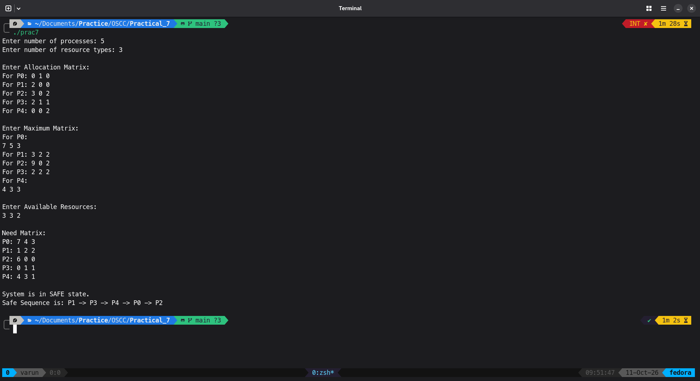

# Program
```C
#include <stdio.h>
int main() {
  int n, m;
  int allocation[10][10];
  int max[10][10];
  int need[10][10];
  int available[10];
  int finish[10] = {0};
  int safe[10];
  int i, j, k;
  int count = 0;
  int found;

  printf("Enter number of processes: ");
  scanf("%d", &n);

  printf("Enter number of resource types: ");
  scanf("%d", &m);

  printf("\nEnter Allocation Matrix:\n");
  for (i = 0; i < n; i++) {
    printf("For P%d: ", i);
    for (j = 0; j < m; j++) {
      scanf("%d", &allocation[i][j]);
    }
  }

  printf("\nEnter Maximum Matrix:\n");
  for (i = 0; i < n; i++) {
    printf("For P%d: ", i);
    for (j = 0; j < m; j++) {
      scanf("%d", &max[i][j]);
    }
  }

  printf("\nEnter Available Resources:\n");
  for (j = 0; j < m; j++) {
    scanf("%d", &available[j]);
  }

  /* Calculate Need Matrix */
  for (i = 0; i < n; i++) {
    for (j = 0; j < m; j++) {
      need[i][j] = max[i][j] - allocation[i][j];
    }
  }

  printf("\nNeed Matrix:\n");
  for (i = 0; i < n; i++) {
    printf("P%d: ", i);
    for (j = 0; j < m; j++) {
      printf("%d ", need[i][j]);
    }
    printf("\n");
  }

  /* Banker's Safety Algorithm */
  while (count < n) {
    found = 0;
    for (i = 0; i < n; i++) {
      if (finish[i] == 0) {
        for (j = 0; j < m; j++) {
          if (need[i][j] > available[j])
            break;
        }
        if (j == m) {
          /* Process can complete */
          for (k = 0; k < m; k++) {
            available[k] = available[k] + allocation[i][k];
          }
          safe[count] = i;
          count++;
          finish[i] = 1;
          found = 1;
        }
      }
    }
    if (found == 0) {
      printf("\nSystem is in UNSAFE state.\n");
      return 0;
    }
  }

  printf("\nSystem is in SAFE state.");

  printf("\nSafe Sequence is: ");
  for (i = 0; i < n; i++) {
    printf("P%d", safe[i]);
    if (i != n - 1)
      printf(" -> ");
  }

  printf("\n");

  return 0;
}
```

## Output

