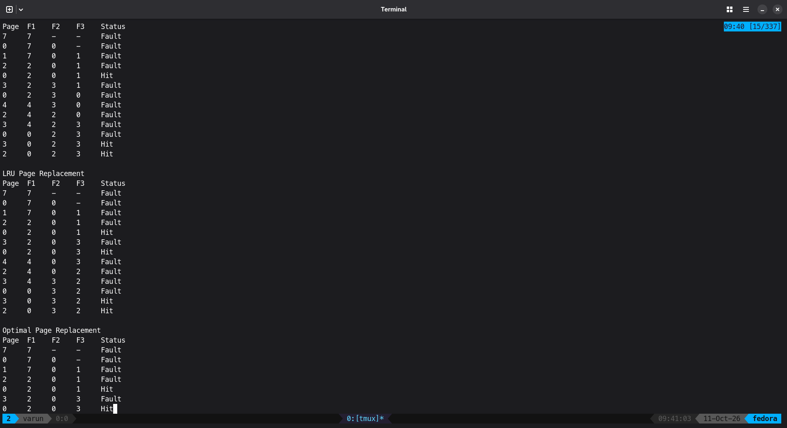
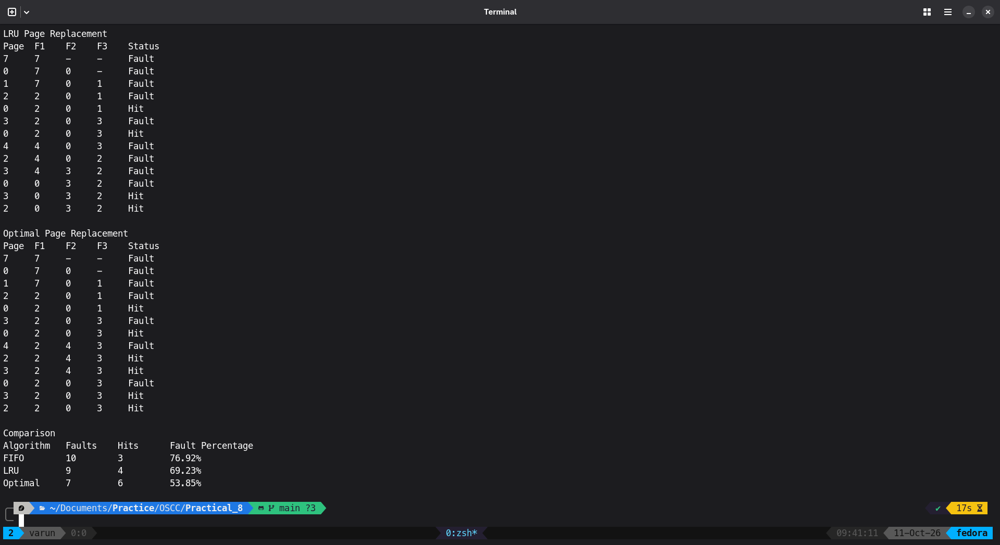

# Program
```C
#include <stdio.h>

#define MAX_REFERENCES 100
#define MAX_FRAMES 20

/* Return the frame index containing page, or -1 if absent. */
int findPage(const int frames[], int count, int page) {
  for (int i = 0; i < count; i++) {
    if (frames[i] == page)
      return i;
  }

  return -1;
}

void showFrames(int page, const int frames[], int count, int capacity,
                int fault) {
  printf("%-6d", page);

  for (int i = 0; i < capacity; i++) {
    if (i < count)
      printf("%-6d", frames[i]);
    else
      printf("%-6s", "-");
  }

  printf("%s\n", fault ? "Fault" : "Hit");
}

void showHeader(const char *name, int capacity) {
  printf("\n%s\n", name);
  printf("%-6s", "Page");

  for (int i = 0; i < capacity; i++)
    printf("F%-5d", i + 1);

  printf("Status\n");
}

int fifo(const int pages[], int n, int capacity) {
  int frames[MAX_FRAMES];
  int count = 0;
  int next = 0;
  int faults = 0;

  showHeader("FIFO Page Replacement", capacity);

  for (int i = 0; i < n; i++) {
    int fault = 0;

    if (findPage(frames, count, pages[i]) == -1) {
      fault = 1;
      faults++;

      /*
       * next points to the next free frame initially.
       * Once full, it points to the oldest loaded page.
       */
      frames[next] = pages[i];

      if (count < capacity)
        count++;

      next = (next + 1) % capacity;
    }

    showFrames(pages[i], frames, count, capacity, fault);
  }

  return faults;
}

int lru(const int pages[], int n, int capacity) {
  int frames[MAX_FRAMES];
  int lastUsed[MAX_FRAMES];
  int count = 0;
  int faults = 0;

  showHeader("LRU Page Replacement", capacity);

  for (int i = 0; i < n; i++) {
    int index = findPage(frames, count, pages[i]);
    int fault = 0;

    if (index == -1) {
      fault = 1;
      faults++;

      if (count < capacity) {
        index = count++;
      } else {
        index = 0;

        for (int j = 1; j < capacity; j++) {
          if (lastUsed[j] < lastUsed[index])
            index = j;
        }
      }

      frames[index] = pages[i];
    }

    /* Update recency on both a hit and a fault. */
    lastUsed[index] = i;

    showFrames(pages[i], frames, count, capacity, fault);
  }

  return faults;
}

int optimal(const int pages[], int n, int capacity) {
  int frames[MAX_FRAMES];
  int count = 0;
  int faults = 0;

  showHeader("Optimal Page Replacement", capacity);

  for (int i = 0; i < n; i++) {
    int fault = 0;

    if (findPage(frames, count, pages[i]) == -1) {
      fault = 1;
      faults++;

      if (count < capacity) {
        frames[count++] = pages[i];
      } else {
        int victim = 0;
        int farthest = -1;

        for (int j = 0; j < capacity; j++) {
          int nextUse = n;

          /* Find this resident page's next reference. */
          for (int k = i + 1; k < n; k++) {
            if (pages[k] == frames[j]) {
              nextUse = k;
              break;
            }
          }

          /*
           * nextUse == n means the page is never
           * referenced again.
           */
          if (nextUse > farthest) {
            farthest = nextUse;
            victim = j;
          }
        }

        frames[victim] = pages[i];
      }
    }

    showFrames(pages[i], frames, count, capacity, fault);
  }

  return faults;
}

int main(void) {
  int pages[MAX_REFERENCES];
  int n, capacity;

  printf("Enter number of page references (1-%d): ", MAX_REFERENCES);

  if (scanf("%d", &n) != 1 || n < 1 || n > MAX_REFERENCES) {
    printf("Invalid number of references.\n");
    return 1;
  }

  printf("Enter the reference string: ");

  for (int i = 0; i < n; i++) {
    if (scanf("%d", &pages[i]) != 1 || pages[i] < 0) {
      printf("Page numbers must be nonnegative integers.\n");
      return 1;
    }
  }

  printf("Enter number of frames (1-%d): ", MAX_FRAMES);

  if (scanf("%d", &capacity) != 1 || capacity < 1 || capacity > MAX_FRAMES) {
    printf("Invalid number of frames.\n");
    return 1;
  }

  int fifoFaults = fifo(pages, n, capacity);
  int lruFaults = lru(pages, n, capacity);
  int optimalFaults = optimal(pages, n, capacity);

  printf("\nComparison\n");
  printf("%-12s%-10s%-10s%s\n", "Algorithm", "Faults", "Hits",
         "Fault Percentage");

  printf("%-12s%-10d%-10d%.2f%%\n", "FIFO", fifoFaults, n - fifoFaults,
         100.0 * fifoFaults / n);

  printf("%-12s%-10d%-10d%.2f%%\n", "LRU", lruFaults, n - lruFaults,
         100.0 * lruFaults / n);

  printf("%-12s%-10d%-10d%.2f%%\n", "Optimal", optimalFaults, n - optimalFaults,
         100.0 * optimalFaults / n);

  return 0;
}
```

## Output


